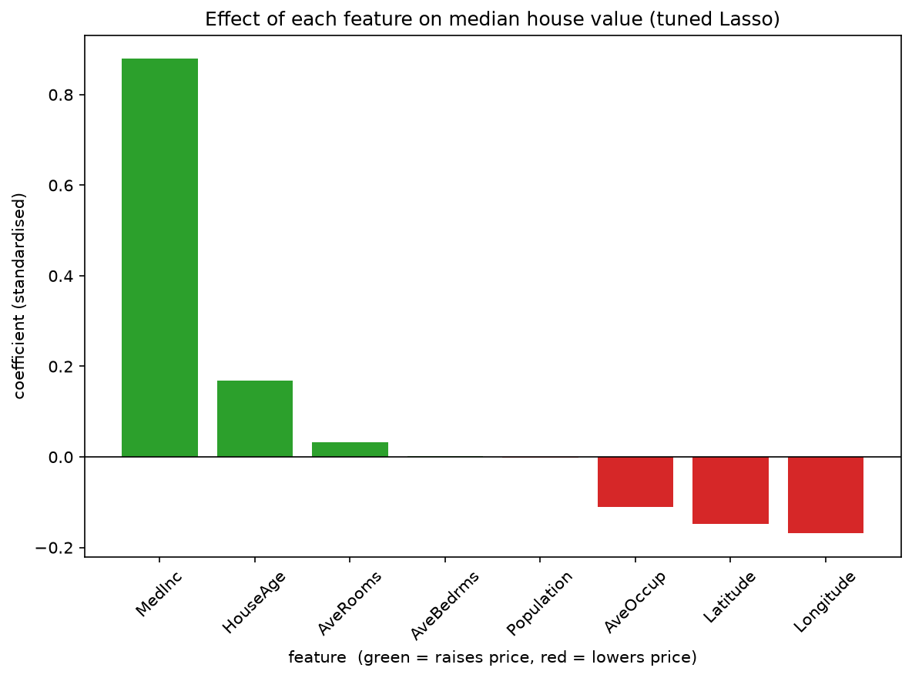

# Week 5 Project — Linear Model Pipeline (California Housing)

CodeTrade AI/ML Internship · Phase 2 · Week 5

## What I built
A complete, leakage-free linear-model pipeline that predicts **median house value** (`MedHouseVal`, units of $100,000) of California census block groups from 8 numeric features.

Steps: explore data → one frozen train/test split → dumb baseline → plain `LinearRegression` → scaled Ridge & Lasso → tune alpha with cross-validation → one sklearn `Pipeline` → interpret coefficients → **single** final test evaluation.

## Data
`california_housing.csv` — 5,000 rows, 8 features + target, no missing values. It is the classic 1990 US Census California housing data (the same data as scikit-learn's `fetch_california_housing`), supplied with the task sheet.

| Feature | Meaning |
|---|---|
| MedInc | Median income in block group ($10,000s) |
| HouseAge | Median house age (years) |
| AveRooms / AveBedrms | Average rooms / bedrooms per household |
| Population | Block-group population |
| AveOccup | Average household size |
| Latitude / Longitude | Location |
| **MedHouseVal** | **Target: median house value ($100,000s)** |

## How to run
```bash
pip install -r requirements.txt
jupyter notebook week5_linear_model_pipeline.ipynb   # Run All
# or run the plain script version:
python week5_linear_model_pipeline.py
```
Keep `california_housing.csv` in the same folder. Everything is reproducible (`random_state=42`).

## Repo contents
| File | Purpose |
|---|---|
| `week5_linear_model_pipeline.ipynb` | Main deliverable — runs top to bottom, with explanations |
| `week5_linear_model_pipeline.py` | Same code as a script |
| `comparison_table.csv` | The comparison table below |
| `coefficients.png` | Labelled coefficient chart (saved with `savefig`) |
| `california_housing.csv`, `requirements.txt` | Data and dependencies |

## Comparison table (metric: R², higher is better)
| Model | Alpha | CV R² (train, 5-fold) | Test R² (final, once) |
|---|---|---|---|
| Baseline (DummyRegressor, mean) | – | -0.002 | – |
| Plain LinearRegression | – | 0.840 | – |
| Ridge (scaled, alpha=1) | 1 | 0.840 | – |
| Lasso (scaled, alpha=1) | 1 | -0.002 | – |
| Ridge tuned (RidgeCV) | 1.0 | 0.840 | – |
| **Lasso tuned (LassoCV) — final Pipeline** | 0.001 | 0.840 | **0.838** |

**Reading the table**
- The baseline (~0) is the floor; every real linear model jumps to ~0.84, so there is strong linear signal.
- Lasso with the default alpha=1 is too strong: it zeroes all 8 coefficients and falls back to the baseline — alpha must be tuned.
- Tuned Lasso, Ridge and plain regression tie on accuracy: with 8 features and 4,000 rows the model is not overfitting, so regularisation cannot improve it much. Tuned Lasso zeroed **0 of 8** coefficients.
- The test score (0.838) matches the CV estimate (0.840): no over-promising, no leakage. Test RMSE ≈ 0.41, MAE ≈ 0.32 (≈ $41k / $32k).
- The test set was used exactly once.

## Interpretation (standardised coefficients, tuned Lasso)


- **MedInc (+0.88)** is by far the strongest driver: richer districts have more expensive houses.
- **HouseAge (+0.17)** raises value moderately; **AveRooms (+0.03)** slightly.
- **Longitude (−0.17), Latitude (−0.15)** and **AveOccup (−0.11)** lower value: northern/eastern areas and crowded households are cheaper.
- **AveBedrms and Population** are ≈ 0 — they add almost nothing once the others are included.
- Confidence: high for the sign and size of MedInc, location, AveOccup, HouseAge; lower for AveRooms/AveBedrms (correlated with each other). These are associations, not causes, and the target is capped at $500k in the source data.

## Ridge vs Lasso for this data
Equal accuracy. Because all 8 features are meaningful and some are correlated, Ridge is a sensible recommendation; Lasso's feature-selection benefit did not appear here. Tuned Lasso is kept as the final Pipeline because its explanation is equally clear.

## The three mistakes avoided
1. **Baseline first** — `DummyRegressor` recorded before any model.
2. **No tuning on test** — alpha chosen by CV on the training part only; test touched once.
3. **Interpretation** — coefficient chart plus written explanation.
